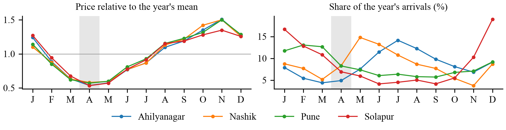

# When Should Onion Farmers Sell?
Price Forecasting and Sell-or-Store Planning

Kanda Code | MS4001 Industry 4.0 | IIT Madras BS

## 1. Problem statement

Rabi onion is about 65% of India's crop and the part that is stored: it is harvested from late March to May, when markets are glutted, and held for the lean months after (NHB, 2018; Khapte et al., 2023). Maharashtra grows about 30% of India's onions, mainly in Nashik, Ahilyanagar (formerly Ahmednagar), Pune and Solapur. Storing pays only if the later price covers storage loss and costs. We ask how much a farmer group with 1,000 tonnes harvested in mid-April should sell in each month from April to December, and what it takes for waiting to pay.

## 2. Motivation for problem selection

Farmers at Lasalgaon, India's largest onion market, sell about 40% of their produce at a loss (Vivek and Mohammed, 2023), and in March 2026 Maharashtra mandi prices fell to Rs 300-800 per quintal against a production cost of about Rs 1,800 (Shagun, 2026). Lack of storage forces distress sales at harvest, while stored onion fetches more from August to November (Khapte et al., 2023). In our data the April price averaged Rs 745 per quintal over 2011-2025 and November Rs 2,138, but the November-to-April ratio ranged from 5.7 (2023) to 1.1 (2025). The four districts carried 85% of Maharashtra's onion arrivals in the 2024 Agmarknet reports.

## 3. Research questions

- **RQ1.** Do onion prices fall when more onion arrives at the mandi?
- **RQ2.** Can a seasonal model forecast April-December prices better than assuming the price stays where it is?
- **RQ3.** Does storing part of the harvest and selling it later earn more than selling everything in April?
- **RQ4.** Does a price forecast lead to better selling decisions than the pattern of past seasons?

## 4. Hypotheses, objectives and constraints

- **H1.** When arrivals rise, prices fall, even after allowing for the usual seasonal pattern.
- **H2.** Winters' seasonal model makes smaller forecast errors than the no-change forecast.
- **H3.** Storing and selling later earns more per tonne than selling at harvest, after all storage and selling costs.
- **H4.** A sales plan built on the forecast earns more than one built on past seasons' average prices.

The objective is the present value at harvest (10% a year) of sales net of a 1% market fee, Rs 500 per tonne for transport and a 1% price discount per month in store, minus storage cost; the decisions are tonnes sold and held each month. At least 250 t is sold at harvest for cash, the store holds 700 t, nothing leaves it until curing ends 15 days after harvest, at most 300 t is sold a month after April, and stock is cleared by December and within the store's holding limit.

## 5. Exploratory data analysis

**Data.** Agmarknet monthly modal price (Rs per quintal) and arrivals (tonnes), January 2011 to December 2025. In each district we use the mandi with the most arrivals among those that miss at most 5% of months with no gap over three months: Pimpalgaon Baswant (Nashik), Newasa-Ghodegaon (Ahilyanagar), Solapur and Pune. 2011 is the earliest start at which all four qualify. Only 19 of 720 mandi-months are unreported, including the April-May 2020 COVID-19 lockdown.

*Figure 1. Mean monthly price relative to the year's mean (left) and share of the year's arrivals (right), 2011-2025; April shaded.*

The price cycle is shared: April prices are 0.53-0.58 times the annual mean and November is the peak at all four mandis (1.35-1.51). Arrivals peak at different times (May at Pimpalgaon, February at Pune, July at Newasa, December at Solapur), so the districts differ in crop calendar more than in price pattern. Solapur's prices average 18% below the four-mandi mean and Nashik's and Ahilyanagar's 8% above. Augmented Dickey-Fuller tests reject a unit root in log price at 5% for three mandis (Solapur p = 0.08) and in the 12-month change in log price for all four (p ≤ 0.007), so the models work with seasonal patterns and year-on-year changes.

## 6. Methodology

The table below shows which model each step uses and why; the paragraphs after it give the details.

| Step | Model or algorithm | Why this choice |
| --- | --- | --- |
| Fill missing months | Lasso regression on nearby mandis' prices in the same month | Uses what similar mandis were paid that month; keeps only the mandis that help |
| RQ1: arrivals and price | Least squares: log price on log arrivals, month dummies and trend | Separates the supply effect from the seasonal cycle |
| RQ2: forecasting | No change; Winters' exponential smoothing; ARIMA | A benchmark; a model of the yearly cycle; the standard time-series model |
| RQ3: sales plan | Dynamic programming (Bellman equation) | The exact best monthly plan under storage loss, costs and limits |
| RQ4: value of forecast | The same plan fed forecast or past seasons' average prices | Isolates what the forecast adds to the seasonal calendar |

**Filling missing months.** Prices at the 33 mandis of the four districts that report at least 80% of months move together, so a missing month is predicted from the other mandis' prices that month by a lasso regression on log prices (Tibshirani, 1996), whose penalty, set by five-fold cross-validation, drops unhelpful mandis. It uses only data up to the forecast date, and filled months are never scored. On 240 runs of one to three known months hidden at random it missed by 8.7%, against 10.6% for ordinary regression on the other three study mandis, 18.6% for log interpolation and 28.8% for a Winters forecast.

**RQ1.** For each mandi, log price is regressed on log arrivals with 11 month dummies and a linear trend; the arrivals coefficient is the percentage change in price for a 1% change in arrivals in a given month.

**RQ2.** At the end of March and of each later month, each model forecasts every month to December from prices up to that date, refitted each time. *No change* carries the last price forward. *Winters' exponential smoothing* (Winters, 1960) updates a level, a trend and 12 monthly factors on log prices, so seasonal effects are percentages. *ARIMA* (Box and Jenkins, 1976) models the 12-month change in log price, stationary by the ADF tests, with the order chosen on validation error among those that converge: (0,1,0). Seasons 2011-2013 are history, 2014-2019 validate and 2020-2025 test. Error is the mean absolute error (MAE) on reported months; relative MAE divides it by the mean price, so 34% means a typical miss of a third of the price. The plans use the model with the lowest validation error.

**RQ3 and RQ4.** A finite-horizon dynamic programme (Bellman, 1957): month *t* runs from April (0) to December (8), the state *s* is the stock in store and the action *x* is tonnes sold. With net price *p*, monthly storage loss *l*, storage cost *c* and monthly discount factor λ, the value of holding *s* tonnes at the start of month *t* is

$$ V_{t}(s) = max_{x} { λ^{t} [ p_{t} x − c (s − x) ] + V_{t+1}( (1 − l)(s − x) ) }

with no stock after December; the constraints of Section 4 restrict *x* and *s*, and backward induction on a 1-tonne grid gives the best plan. Three stores are compared: a *traditional store* loses 54.9% of weight over 120 days (ICAR) and rents at Rs 140 per quintal a season in Nashik; an *improved on-farm store* loses 10% over six months and costs Rs 167 per quintal to build, spread over a season (Khapte et al., 2023); a *cold store* loses 7.1% over 120 days (ICAR) at an assumed Rs 700 per tonne-month. Plans are valued at actual prices against an April sale. A *March plan* is fixed from the March forecast; a *monthly re-plan* re-solves with each new forecast. For RQ4 the same programme is fed the average of earlier seasons' prices (a *past-seasons plan* needing no forecast) and the actual prices (*perfect foresight*).

## 7. Results

**RQ1: H1 supported in three of four districts.** The arrivals coefficient is -0.23 at Pimpalgaon Baswant (p < 0.001), -0.18 at Pune (p = 0.006) and -0.15 at Newasa (p = 0.024): 10% more arrivals goes with a 1.5-2.3% lower price. At Solapur it is +0.06 (p = 0.26). R² is 0.38-0.45, every F-test has p < 0.001 and the arrivals variance inflation factor is at most 2.3; residuals are autocorrelated (lag-1 about 0.8), so the p-values are optimistic.

| Forecast model | Validation MAE | Validation relative MAE | Test MAE | Test relative MAE |
| --- | ---: | ---: | ---: | ---: |
| No change | Rs 794/q | 48.2% | Rs 795/q | 40.6% |
| Winters | Rs 727/q | 44.1% | Rs 658/q | 34.0% |
| ARIMA(0,1,0) | Rs 1,105/q | 66.6% | Rs 1,084/q | 55.9% |

**RQ2: H2 supported.** Winters had the lowest error in both periods and beat no change on 58% of forecasts, so it drives the plans. Errors are large as prices are volatile: in 2017, 2019 and 2023 November prices were over five times April's. ARIMA carries last year's movement into this year and was worse than no change.

**RQ3: H3 supported for low-loss stores, rejected for the traditional store.** An April sale netted Rs 8,497 per tonne over the test seasons 2020-2025. With a traditional store the plans sold everything at harvest, and even perfect foresight would have gained only Rs 465. The improved store gained most, Rs 3,854 per tonne or 45%, and cold storage Rs 2,969, its rent eating part of the gain. The improved-store March plan gained in 19 of 24 market-seasons; in 2025 all four districts lost (Rs -1,713 on average) as prices fell after harvest. The plans sold 300 t at harvest, the least that fits the 700 t store, then about 220 t in August, 160 t in September and 260 t in October, as the store must be empty after six months.

| Improved store, test seasons (Rs/t) | March plan | Monthly re-plan | Past seasons | Perfect foresight |
| --- | ---: | ---: | ---: | ---: |
| Nashik (Pimpalgaon Baswant) | 5,159 | 5,159 | 5,959 | 6,799 |
| Ahilyanagar (Newasa) | 4,586 | 4,586 | 4,586 | 6,418 |
| Solapur | 3,022 | 2,930 | 2,692 | 4,494 |
| Pune | 2,649 | 2,649 | 2,535 | 4,482 |
| Four districts | 3,854 | 3,831 | 3,943 | 5,548 |

Nashik and Ahilyanagar gained most; Solapur, with prices 18% lower, and Pune about half as much. The gain falls to Rs 2,933 if storage cost doubles, 2,815 if loss doubles, 3,258 with a 2% monthly quality discount, 2,765 if half the harvest is sold for cash and 3,448 at 20% interest.

**RQ4: H4 not supported.** Forecast plans did not beat the past-seasons plan (Rs 3,854 vs 3,943 in testing, 4,503 vs 4,607 in validation): the value is in seasonal timing, which past seasons reveal.

## 8. Managerial implications

**When to sell.** With an improved on-farm store, sell 300 t at harvest and the rest from August to October by the past-seasons calendar. With a traditional store, sell at harvest.

**What to invest in.** The improved store beat rented cold storage in all four districts, most in Nashik and Ahilyanagar; its average gain, Rs 38.5 lakh on 1,000 t, is over three times its Rs 11.7 lakh build cost for 700 t. Weigh stock or use temperature and humidity sensors to track actual loss, since loss and storage cost decide whether storing pays.

**Risk and limits.** Storing lost money in 2025, so the harvest sale should leave cash to carry such a year. Modal prices mix grades, costs are assumptions, and large sales could move prices.

## 9. References

- 1. Directorate of Marketing and Inspection. Agmarknet 2.0, onion prices and arrivals. agmarknet.gov.in.
- 2. National Horticulture Board (2018). Onion: monthly report, June 2018.
- 3. Khapte, P. S. et al. (2023). An innovative onion storage structure. Indian Horticulture, May-June, 39-41.
- 4. Vivek, T. R., Mohammed, F. (2023, 8 April). Onions in India a political nightmare. ThePrint.
- 5. Shagun (2026, 31 March). War in West Asia ... disrupt onion exports, lead to price crash. Down To Earth.
- 6. ICAR. Onion cold storage: potential to stabilize price fluctuation. icar.org.in/en/node/4701.
- 7. Tibshirani, R. (1996). Regression shrinkage and selection via the lasso. J. R. Stat. Soc. B 58(1), 267-288.
- 8. Winters, P. R. (1960). Forecasting sales by exponentially weighted moving averages. Mgmt. Sci. 6(3), 324-342.
- 9. Box, G. E. P., Jenkins, G. M. (1976). Time Series Analysis: Forecasting and Control. Holden-Day.
- 10. Bellman, R. (1957). Dynamic Programming. Princeton University Press.
